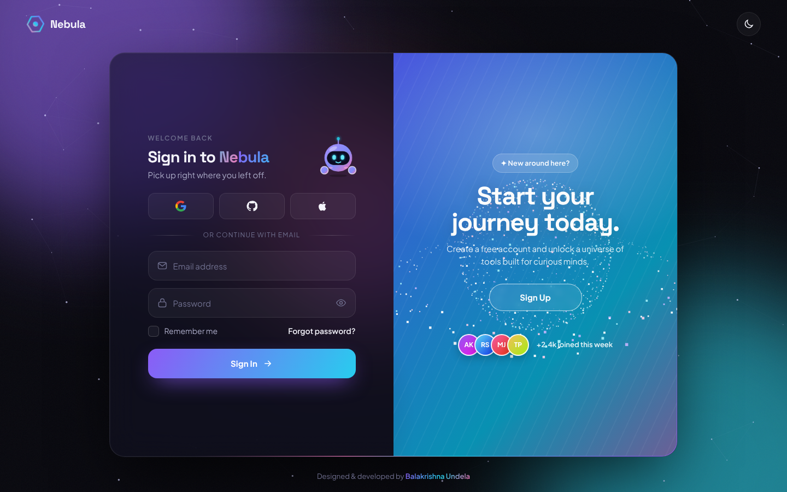
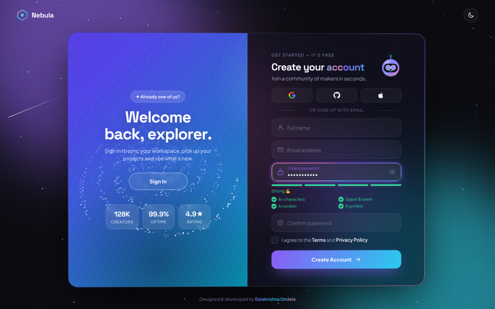
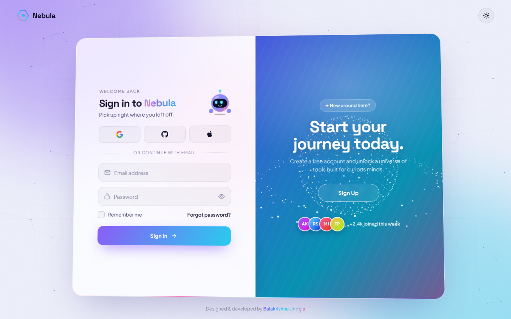
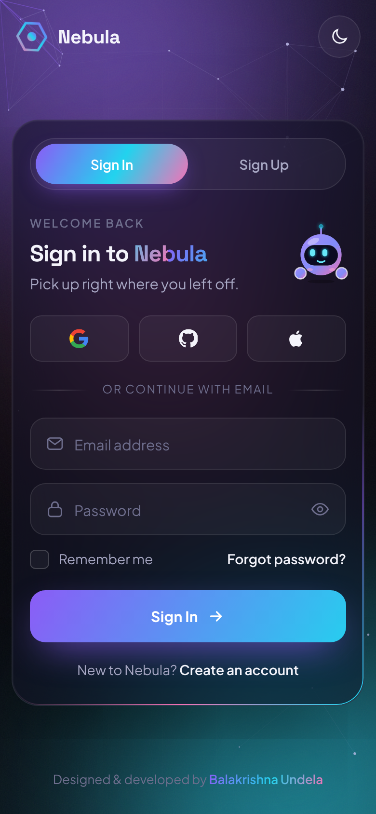

<div align="center">

# ✦ Nebula — Sign In / Sign Up

**A modern, animated and accessible authentication UI built with pure HTML, CSS & JavaScript.**

[](https://balakrishna-dev.github.io/login-signup-page/)




</div>

---

## 🌌 About

**Nebula** is a login and sign-up experience that aims to feel *alive*. A glassmorphic card floats over a drifting aurora and an interactive constellation. A robot mascot reacts to everything you type, and a 3D particle planet turns into a galaxy as the showcase panel slides between **Sign In** and **Sign Up**.

It uses no frameworks, libraries or build step: just semantic HTML, modern CSS and plain JavaScript.

## ✨ Features

| | Feature | Details |
|---|---|---|
| 🎬 | **Cinematic intro** | The logo draws itself, the letters rise in, and the loader lifts away like a curtain |
| 🤖 | **Interactive mascot** | A little robot that follows your cursor and your typing with its eyes, covers its eyes while you type a password, peeks when you show it, frowns at errors and jumps on success |
| 🪐 | **3D particle morph** | 900 particles form a ringed planet and turn into a spiral galaxy when you switch forms. The scene rotates with your mouse |
| 🌊 | **Liquid sliding panel** | The showcase panel bends like liquid as it glides between the forms, and its headline appears letter by letter |
| 🌗 | **Circular theme reveal** | Dark and light themes spread out in a circle from the toggle (View Transitions API), follow your system setting and are remembered |
| 🌠 | **Living background** | A constellation drawn toward the cursor, shooting stars, and shockwaves when you click empty space |
| 🧲 | **Magnetic buttons & ripples** | Buttons lean toward the cursor, ripple when clicked, and the submit button turns into a check mark on success |
| 🔦 | **Cursor spotlight & ring** | A soft light follows the pointer across the glass card, and a cursor ring reacts to what's underneath |
| ✨ | **Animated focus border** | A rotating gradient border lights up the active field |
| 🔐 | **Live password strength meter** | A 4-segment meter and a checklist of rules (length, case, number, symbol) |
| ✅ | **Real-time validation** | Inline error messages, a shake on invalid fields and green states for valid ones |
| ⇪ | **Caps Lock warning** | A heads-up while you type a password |
| 📨 | **Forgot-password modal** | Pre-fills your email, traps focus and closes on <kbd>Esc</kbd> |
| 🎉 | **Success celebration** | An animated check mark that draws itself, plus a confetti burst |
| 📱 | **Fully responsive** | A segmented tab switch with a spring-animated pill on mobile |
| ♿ | **Accessible** | Semantic markup, ARIA roles, `aria-live` errors, keyboard support, `inert` hidden panes and full `prefers-reduced-motion` support |

## 📸 Screenshots

<table>
  <tr>
    <td width="50%"></td>
    <td width="50%"></td>
  </tr>
  <tr>
    <td align="center"><b>Sign Up — dark</b></td>
    <td align="center"><b>Sign In — light</b></td>
  </tr>
</table>

<p align="center">
  
  <br /><b>Mobile</b>
</p>

## 🛠️ Tech Stack

- **HTML5**: semantic structure, ARIA and native form features
- **CSS3**: custom properties, `@property` animated gradients, animated SVG, `backdrop-filter`, CSS grid and flexbox, masks, keyframe animations and media queries
- **JavaScript (ES6+)**: Canvas 2D API (a hand-written 3D projection for the particle scene), View Transitions API, `requestAnimationFrame`, pointer events, `localStorage` and async/await

## 🚀 Getting Started

```bash
# clone the repository
git clone https://github.com/balakrishna-dev/login-signup-page.git
cd login-signup-page

# open it directly…
open index.html            # macOS
start index.html           # Windows
xdg-open index.html        # Linux

# …or serve it locally
npx serve .
```

### Deploy on GitHub Pages

1. Go to **Settings → Pages**.
2. Under *Build and deployment*, choose **Deploy from a branch**.
3. Select the `main` branch and the `/ (root)` folder, then click **Save**.
4. The site goes live at `https://balakrishna-dev.github.io/login-signup-page/`.

## 📁 Project Structure

```
login-signup-page/
├── index.html            # markup for both forms, modals and the showcase panel
├── assets/
│   ├── css/style.css     # design tokens, themes, layout and animations
│   ├── js/main.js        # mode switching, validation, effects and canvas
│   └── img/              # favicon and screenshots
├── LICENSE
└── README.md
```

## 🎨 Design Notes

- **Palette**: violet `#8b5cf6` → cyan `#22d3ee` → pink `#f472b6`, on a deep space `#07070d`.
- **Typography**: *Space Grotesk* for headings and *Plus Jakarta Sans* for body text.
- **Motion**: custom `cubic-bezier` easing curves for smooth, springy transitions. All motion turns off under `prefers-reduced-motion`.

> ℹ️ This is a front-end showcase. Form submissions and social logins are simulated, so no data leaves your browser.

## 👨‍💻 Author

**Balakrishna Undela**

[](https://github.com/balakrishna-dev)

If you like this project, please consider giving it a ⭐. It really helps!

## 📄 License

Released under the [MIT License](LICENSE) © 2026 Balakrishna Undela.
